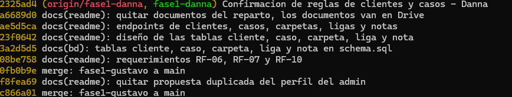
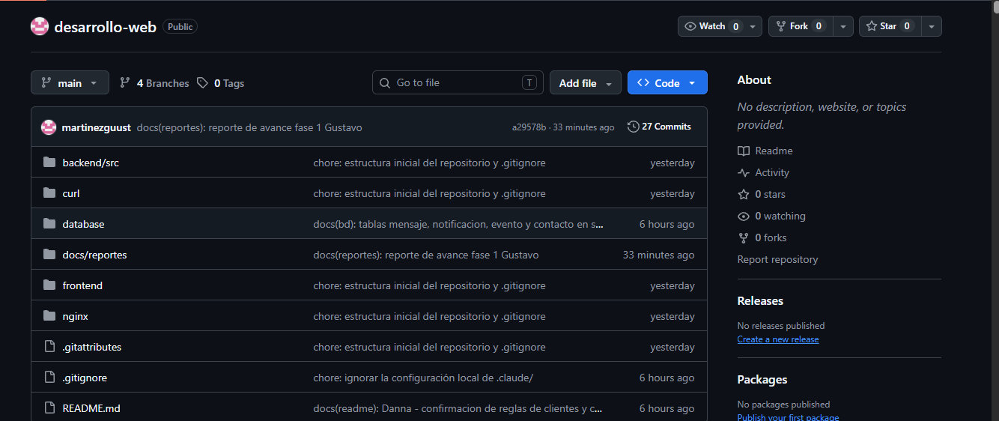

# Reporte de Avance del Proyecto

**Equipo:** Juris Magna  
**Integrante:** Danna Gabriela Garcia Castillo  
**Fecha:** 10/11/2026  
**Número de reporte:** 1 (Fase 1 — Análisis y diseño)  
**Repositorio GitHub:** https://github.com/martinezguust/desarrollo-web  

# 1. Actividades realizadas

En esta primera fase me enfoqué en el análisis, diseño de requerimientos y la estructura de datos del módulo que me corresponde:

- Redacté mis requerimientos en el README: RF-06 (registro de clientes), RF-07 (creación y actualización de casos) y RF-10 (notas privadas del abogado).
- Diseñé las tablas de la base de datos en `database/schema.sql` para mi módulo: `cliente`, `caso`, `carpeta`, `liga` y `nota`, definiendo sus llaves foráneas, restricciones y el borrado en cascada para carpetas y ligas.
- Definí los endpoints REST para clientes, casos (incluyendo el archivo histórico), carpetas, ligas y notas, agregando ejemplos de JSON, filtros de consulta por query string y códigos de error.
- Evaluamos el diseño y decidimos eliminar la tabla `documento`, ya que los documentos del cliente se gestionan directamente mediante su enlace a Google Drive como en el prototipo original.
- Revisé y ajusté la tabla de reparto de tareas dentro del README para dejar clara mi responsabilidad en el proyecto.
- Cloné el repositorio en mi entorno WSL y confirmé la subida de reglas desde mi cuenta de gitHub

**Evidencias Visuales**

# 2. Evidencias de trabajo
| Actividad | Integrante responsable | Enlace a commit |
|------------|------------------------|-----------------|
| Requerimientos RF-06, RF-07 y RF-10 | Danna | https://github.com/martinezguust/desarrollo-web/commit/08be7585e0831b36544f9c179f5e95df87919b45 |
| Tablas cliente, caso, carpeta, liga y nota | Danna | https://github.com/martinezguust/desarrollo-web/commit/3a2d5d52a13135dd46fe9ab9bc2f0f7eba72495f |
| Descripción de mis tablas en el README | Danna | https://github.com/martinezguust/desarrollo-web/commit/23f0642d0dbe61c48094c1036bf6525724bc0ef1 |
| Rutas de la API de clientes, casos, carpetas, ligas y notas | Danna | https://github.com/martinezguust/desarrollo-web/commit/ae5d5ca661a4f34bfae88376e1a1312c4aa93b72 |
| Ajuste del diseño: los documentos se manejan con el enlace a Drive | Danna | https://github.com/martinezguust/desarrollo-web/commit/a6689d04893161de34dc8e54d0414af5d40da68d |
| Revisión de mi sección del reparto en el README | Danna | https://github.com/martinezguust/desarrollo-web/commit/2325ad406cf649e44672b70fd66ddc5d48285764 |
| Confirmación de las reglas de clientes y casos | Danna | https://github.com/martinezguust/desarrollo-web/commit/e3d3362393dfadb55823b6cf27e797245350b4de |

> Los enlaces funcionan después de hacer `push` en la rama `fase1-danna`.

# 3. Problemas encontrados

- **Documentos sin pantalla en el prototipo:** Al revisar el prototipo nos dimos cuenta de que la función que listaba los documentos del cliente nunca se mostraba. Decidimos quitar la tabla `documento` y usar directamente el enlace a Google Drive para no complicar el flujo.
- **Estado "Cancelado":** El archivo histórico tenía un filtro de "Cancelados", pero ese estado no existía en el formulario ni en el diseño inicial de la base de datos; por ello, lo agregamos como un estado válido del caso.
- **Materias:** El documento de diseño listaba 7 materias, pero el formulario original tenía 18. Decidimos usar las 18 materias, guardándolas como texto y validándolas desde el servicio.
- **Número de expediente:** El prototipo lo calculaba directamente en el navegador; definimos que ahora lo genere el backend para evitar errores,

# 4. Avance funcional

- **Terminado:** Requerimientos, tablas y endpoints del módulo del abogado documentados en el README y en `schema.sql`. Ya cloné el repositorio en mi WSL y confirmé las reglas de clientes y casos desde mi cuenta
- **Pendiente:** Probar la estructura en MySQL y empezar a programar la lógica del backend en la Fase 2.

# 5. Uso de IA generativa

- **Herramienta utilizada:** Claude Code 
- **Actividad para la que se utilizó:** Análisis del prototipo, diseño de tablas, definición de endpoints y redacción de requerimientos
- **Código o contenido generado:** Mi sección en `README.md` (RF-06, RF-07, RF-10, tablas y endpoints) y mis tablas en `database/schema.sql`.
- **Modificaciones realizadas por el equipo:** Ajustamos la estructura de los datos según las necesidades reales del sistema; por ejemplo, eliminamos la tabla de documentos para trabajar con el enlace a Drive, agregamos el estado cancelado a los casos y trasladamos la generación del número de expediente hacia el backend
- **Forma en que se verificó el resultado:** Comparación de los campos de las tablas directamente con los formularios del prototipo original (cliente, caso, carpeta, liga, nota) y revisión de los cambios mediante `git log`.

# 6. Participación individual

- **Danna Gabriela García Castillo:** Me encargué de analizar el prototipo original para definir y redactar los requerimientos de mi módulo (RF-06, RF-07 y RF-10). Diseñé la estructura de las tablas `cliente`, `caso`, `carpeta`, `liga` y `nota` en `schema.sql` con sus relaciones y restricciones en cascada, y especifiqué los endpoints REST en el README. También configuré mi entorno local en WSL, cloné el repositorio y dejé listas mis confirmaciones de cambios con Git para continuar con la implementación del proyecto,

# 7. Próximas actividades

- Fase 2.Danna: probar la conexión a MySQL con mi IP
- Crear las entidades y repositorios de Cliente, Caso, Carpeta, Liga y Nota.
- Implementar los endpoints POST y GET de mi módulo.
- Realizar las pruebas de comunicación de la API usando cURL.

## Observaciones adicionales

- Reglas acordadas: no se permite eliminar un cliente con casos (retorna código 409); al cerrar un caso (Ganado, Perdido o Cancelado) se llena la fecha de fin; al editar un cliente, si la contraseña se manda vacía no se cambia