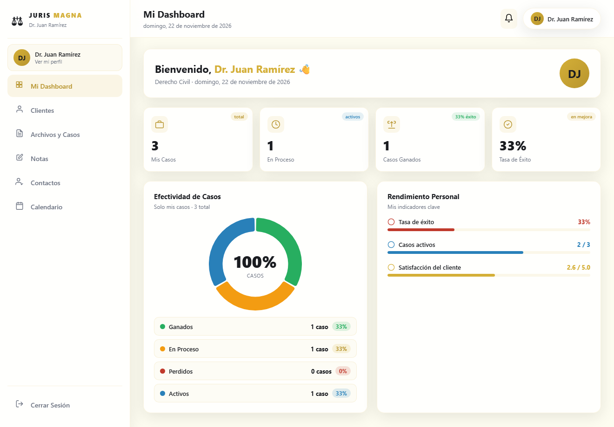
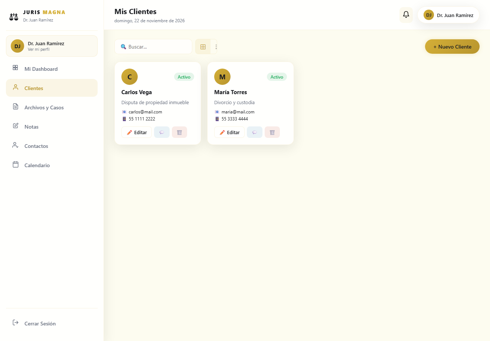
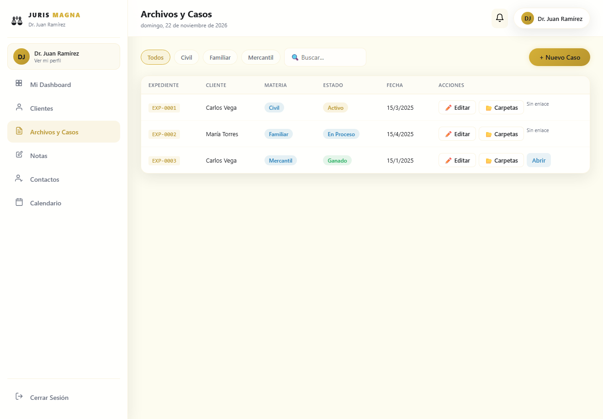
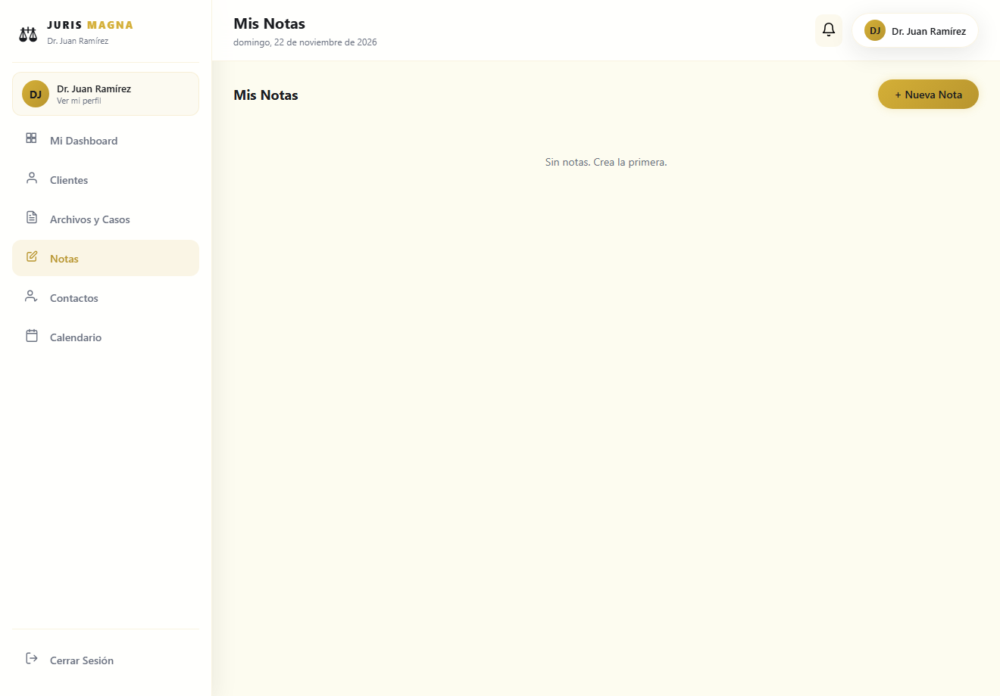

# Reporte de Avance del Proyecto

**Equipo:** Juris Magna
**Integrante:** Danna Gabriela Garcia Castillo
**Fecha:** 22/11/2026
**Número de reporte:** 5 (Fase 5 — Versión candidata)
**Repositorio GitHub:** https://github.com/martinezguust/desarrollo-web
**Release:** https://github.com/martinezguust/desarrollo-web/releases/tag/V5

# 1. Actividades realizadas

- Probé de nuevo todo mi módulo (clientes, casos, archivo histórico, carpetas, ligas y notas), tanto con las pruebas CURL como en el navegador a través de nginx.
- Corregí dos detalles que encontré al probar::
  - En la tabla de casos, el estado "En Proceso" aparecía pegado como "EnProceso". Ahora se muestra bien, sin cambiar cómo se guarda.
  - Cada vez que se corrían las pruebas CURL, el administrador recibía el aviso "Dr. Juan Ramírez agregó a Laura Prueba". Ahora ese aviso se borra al terminar
- En el README agregué la sección de mi módulo y cómo instalar MySQL en Windows: el servicio, la base de datos, los permisos del usuario, la regla del firewall, cómo conectarse desde WSL y una tabla de errores comunes
- Revisé por última vez mis 4 páginas del abogado: cargan datos reales y no muestran errores

# 2. Evidencias de trabajo

| Actividad | Integrante responsable | Enlace a commit |
|------------|------------------------|-----------------|
| Revisión final del módulo del abogado, estado "En Proceso", limpieza del aviso de prueba y README | Danna (en pareja con Gustavo) | https://github.com/martinezguust/desarrollo-web/commit/a94082e2af5ec365998ea1b33f7c5cebf23019b5 |
| Integración de la rama fase5-danna a main | Gustavo | https://github.com/martinezguust/desarrollo-web/commit/44466bd6e775ea2bbbb994b746a776246f61c3f5 |

**Pruebas:**
- Pruebas CURL (`bash curl/pruebas.sh`): **190 pruebas, 0 fallas**, de las cuales 64 son de mi módulo. La salida completa está en `evidencias/curl-danna.txt`.

Algunos resultados de mis pruebas CURL:

| Prueba | Código esperado | Respuesta |
|---|---|---|
| Crear un caso (genera el siguiente expediente) | 200 | `{"numeroExpediente":"EXP-0006","estado":"Activo"}` |
| Cerrar el caso como Ganado | 200 | Se llena la fecha de fin y aparece en el histórico |
| Caso de un cliente que no es de ese abogado | 400 | `{"error":"El cliente no pertenece a ese abogado"}` |
| Eliminar un cliente que todavía tiene casos | 409 | `{"error":"No se puede eliminar: el cliente todavía tiene casos"}` |

**Capturas de mis páginas:**

# 3. Problemas encontrados

- **Texto interno en pantalla:** el estado "EnProceso" se veía tal como se guarda. Agregué que se muestre como "En Proceso".
- **Avisos de prueba acumulados:** el aviso del cliente de prueba se quedaba en la campana del administrador. Ahora se borra al terminar las pruebas.

# 4. Avance funcional

- **Ya funciona:** el dashboard del abogado, los clientes, los casos con número de expediente automático, el archivo histórico, las carpetas y ligas, y las notas. El README ya explica cómo instalar MySQL y crear la base de datos

# 5. Uso de IA generativa

- **Herramienta utilizada:** Claude.
- **Actividad para la que se utilizó:** fue un apoyo para revisar mi módulo, corregir los detalles que salieron en las pruebas y redactar mi parte del README.
- **Código o contenido generado:** las dos correcciones y mi parte del README. Las pruebas unitarias no las hizo Claude: las hago yo con mi propia IA.
- **Modificaciones realizadas por el equipo:** decidimos que las pruebas CURL borren todo lo que crean y que el README explique paso a paso la instalación de MySQL, porque fue lo que más problemas nos dio en las fases anteriores.
- **Forma en que se verificó el resultado:** se corrieron las pruebas CURL (190 de 190) y revisé mis páginas en el navegador. Estoy estudiando el código para poder explicarlo en la defensa.

# 6. Participación individual

- En esta fase revisé mi módulo del abogado, corregí cómo se muestra el estado de los casos y que el aviso de prueba no se quedara guardado, y escribí mi parte del README con la instalación de MySQL, Revisé con Gustavo que mis páginas funcionaran con datos reales

# 7. Próximas actividades

- Terminar mis pruebas unitarias con mi propia IA y subirlas desde mi cuenta.
- Seguir el README en mi laptop para comprobar que todo funciona.
- Preparar mi parte del video y del documento de la entrega final.

## Observaciones adicionales

- Las tablas no se crean a mano: el backend las crea al arrancar y carga los datos de prueba sin duplicarlos.
- El release de esta fase se llama **V5**.
