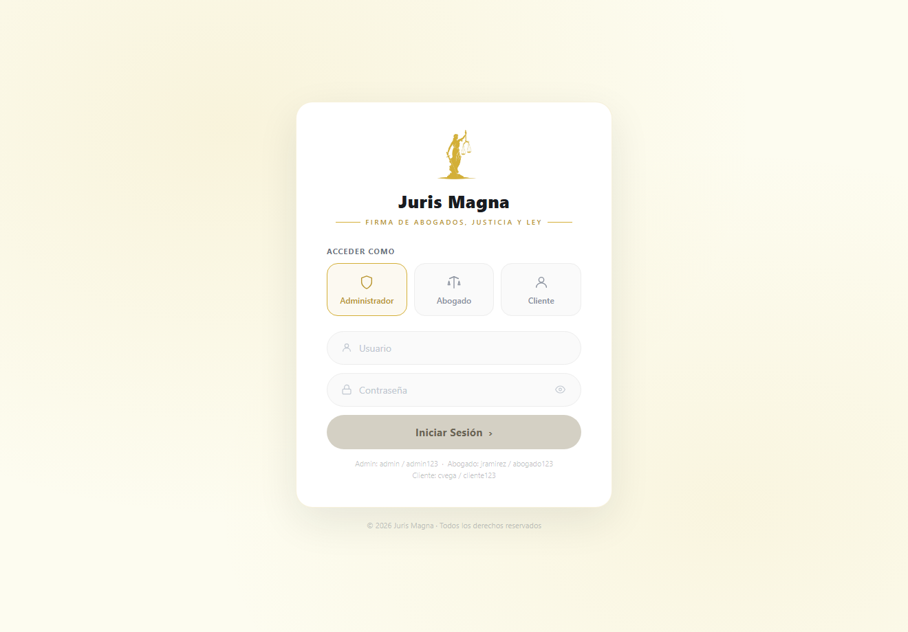
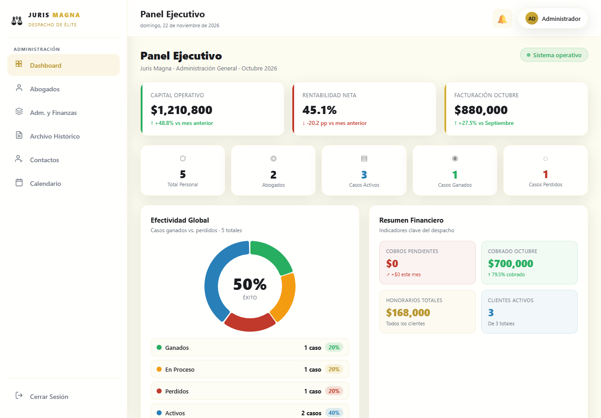
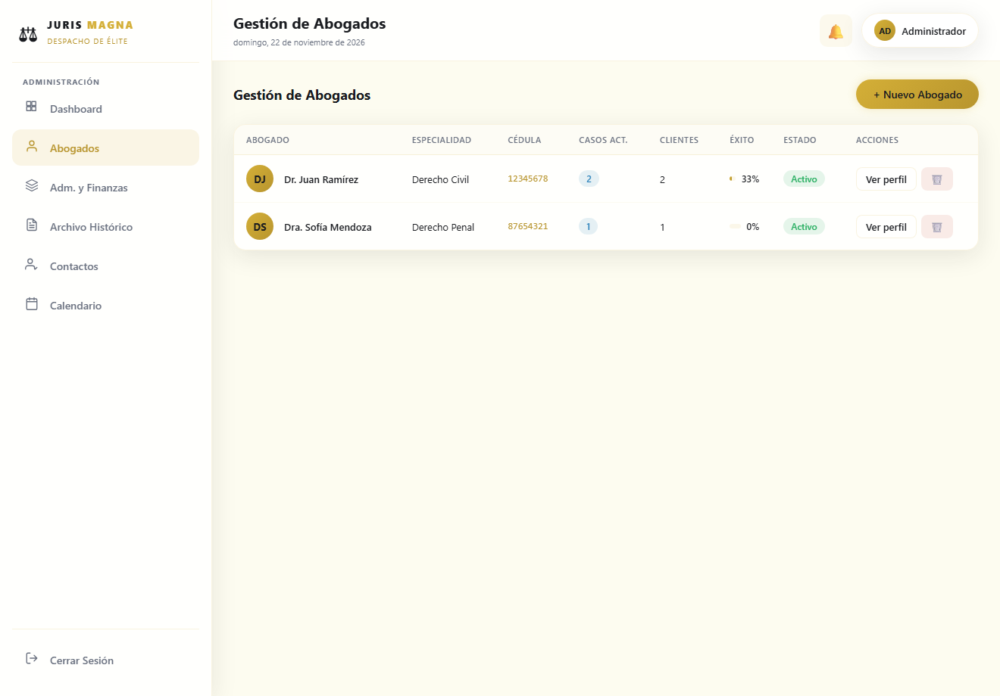
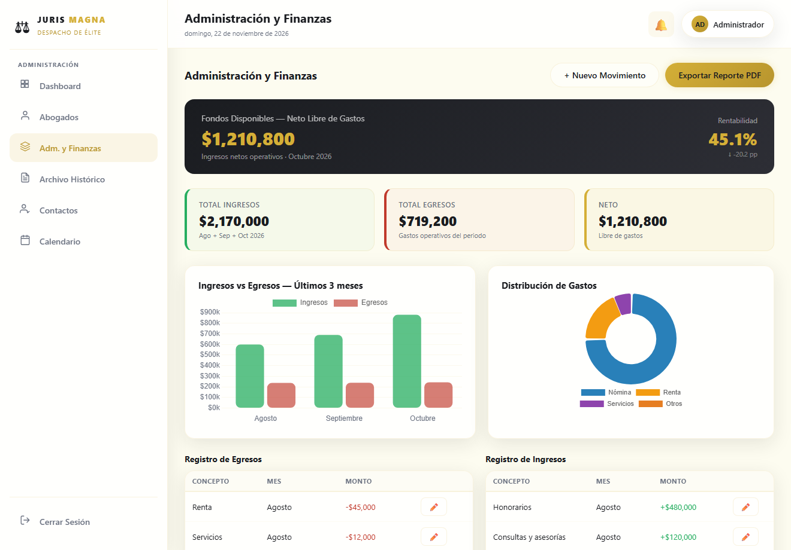
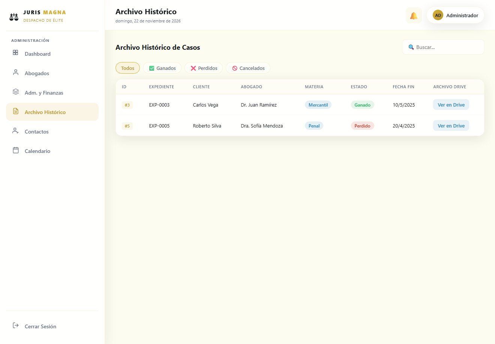

# Reporte de Avance del Proyecto

**Equipo:** Juris Magna
**Integrante:** Gustavo Adolfo Martínez Martínez
**Fecha:** 22/11/2026
**Número de reporte:** 5 (Fase 5 — Versión candidata)
**Repositorio GitHub:** https://github.com/martinezguust/desarrollo-web
**Release:** https://github.com/martinezguust/desarrollo-web/releases/tag/V5

---

# 1. Actividades realizadas

- Probé de nuevo todo mi módulo (inicio de sesión, abogados, dashboards, finanzas, movimientos y página de estado), tanto con las pruebas CURL como en el navegador a través de nginx.
- Corregí dos detalles que encontré al probar:
  - Las pruebas CURL dejaban una foto de prueba en el perfil del administrador cada vez que se corrían. Ahora esa prueba usa un abogado de prueba que se borra al final.
  - Al eliminar un abogado se borraba su foto, pero no la de su usuario. Ahora se borran las dos.
- Dejé lista la configuración para las pruebas unitarias, con una base de datos en memoria, para que se puedan correr sin MySQL y sin tocar los datos reales.
- Hice las pruebas unitarias de `AbogadoServicio`: 8 pruebas que revisan crear un abogado y su usuario, la contraseña encriptada, el usuario repetido, los datos faltantes, el estado inválido, buscar, editar y eliminar.
- En el README reescribí la descripción del sistema y agregué la sección de mi módulo, los requisitos, cómo clonar el repositorio, cómo instalar nginx, una tabla de problemas comunes y los usuarios de prueba.
- Revisé por última vez mis 5 páginas (inicio de sesión y las 4 del administrador): cargan datos reales y no muestran errores.

---

# 2. Evidencias de trabajo

| Actividad | Integrante responsable | Enlace a commit |
|------------|------------------------|-----------------|
| Revisión final, configuración de pruebas, corrección de fotos y README | Gustavo | https://github.com/martinezguust/desarrollo-web/commit/fc159517d74dd403d2b73477e8ce605a77110c3f |
| Integración de la rama fase5-gustavo a main | Gustavo | https://github.com/martinezguust/desarrollo-web/commit/61808c9247eb6385f0aafdd529e9a5d4dcddb6af |
| Pruebas unitarias de AbogadoServicio | Gustavo | https://github.com/martinezguust/desarrollo-web/commit/25abac6 |

**Pruebas:**
- Pruebas CURL (`bash curl/pruebas.sh`): **190 pruebas, 0 fallas**, de las cuales 55 son de mi módulo. La salida completa está en `evidencias/curl-gustavo.txt`.
- Pruebas unitarias (`./mvnw test`): **8 pruebas, 0 fallas, BUILD SUCCESS**.

Algunos resultados de mis pruebas CURL:

| Prueba | Código esperado | Respuesta |
|---|---|---|
| Inicio de sesión de un cliente | 200 | `{"rol":"CLIENTE","nombre":"Carlos Vega"}` |
| Contraseña incorrecta | 401 | `{"error":"Usuario, contraseña o rol incorrectos"}` |
| Eliminar un abogado con clientes y casos | 409 | `{"error":"No se puede eliminar: el abogado todavía tiene clientes o casos asignados"}` |
| Reporte de finanzas con 13 meses | 400 | `{"error":"El parámetro meses debe estar entre 1 y 12"}` |

**Capturas de mis páginas:**

---

# 3. Problemas encontrados

- **Datos de prueba que se quedaban:** cada vez que se corrían las pruebas CURL, el administrador se quedaba con una foto de prueba. Cambié la prueba para que use un abogado temporal.
- **Fotos que no se borraban:** al eliminar un abogado quedaba guardada la foto de su usuario. Agregué que también se borre.
- **Pruebas unitarias sin MySQL:** sin una configuración propia, las pruebas habrían intentado conectarse a MySQL. Agregué una configuración solo para pruebas, con una base de datos en memoria.

---

# 4. Avance funcional

- **Ya funciona:** el inicio de sesión de los tres roles, la gestión de abogados, el dashboard, las finanzas con gráficas y PDF, el archivo histórico y la página de estado. El README ya explica cómo instalar y correr el sistema.
- **Pendiente:** probar el sistema desde un clon limpio siguiendo solo el README, y preparar el video y el documento de la entrega final.

---

# 5. Uso de IA generativa

- **Herramienta utilizada:** Claude.
- **Actividad para la que se utilizó:** fue un apoyo para revisar mi módulo, corregir los detalles que salieron en las pruebas y redactar mi parte del README. Aparte, usé Claude en el chat para hacer mis pruebas unitarias de `AbogadoServicio`.
- **Código o contenido generado:** las correcciones de las fotos, la configuración de pruebas, mi parte del README y la clase de pruebas unitarias. Revisé cada parte antes de aceptarla.
- **Modificaciones realizadas por el equipo:** decidimos que las pruebas CURL borren todo lo que crean, para poder correrlas varias veces sin ensuciar la base de datos. Para las pruebas unitarias le pasé a Claude el código real de mi servicio y de los modelos, y le pedí que también revisara que la contraseña se guardara encriptada y que un abogado inactivo quedara sin acceso.
- **Forma en que se verificó el resultado:** corrí las pruebas CURL (190 de 190), corrí `./mvnw test` (8 de 8) y revisé mis páginas en el navegador. Estoy estudiando el código para poder explicarlo en la defensa.

---

# 6. Participación individual

- **Gustavo Adolfo Martínez Martínez:** En esta fase revisé y corregí mi módulo, dejé lista la configuración de pruebas para el equipo, hice las pruebas unitarias de `AbogadoServicio` y escribí mi parte del README, incluida la instalación de nginx. También junté el trabajo de las tres en la rama principal.

---

# 7. Próximas actividades

- Clonar el repositorio en limpio y seguir solo el README para comprobar que todo funciona.
- Preparar el video y el documento de la entrega final.
- Estudiar mi código para la defensa.

---

## Observaciones adicionales

- Las pruebas CURL ahora borran todo lo que crean, así que se pueden correr las veces que sea necesario.
- El release de esta fase se llama **V5**.